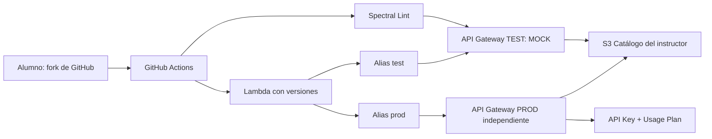

# MOD7-LAB4 · Gobierno y ciclo de vida de APIs (AWS + GitHub Actions)

**Laboratorio educativo para hacer fork.** Duración guiada: 90 min; propuesto: 25–30 min. Nivel: intermedio. Cuenta AWS compartida, con permisos preparados por el instructor.

> **Importante:** TODOS los datos bancarios son ficticios. La etapa PROD es una simulación docente. El catálogo público en S3 Website funciona por HTTP, sin CloudFront ni HTTPS. No colocar información sensible en el catálogo.

## 1. Objetivos

Al terminar podrás: (1) validar contratos OpenAPI con Spectral; (2) desplegar una API MOCK en API Gateway REST; (3) integrar una Lambda versionada a TEST; (4) promover un alias validado a un entorno PROD independiente y protegido con API Key; (5) actualizar y explorar un catálogo compartido alojado en S3; (6) limpiar tus recursos sin afectar a otros estudiantes.

**API guiada:** `GET /clientes/{cliente-id}/cuentas`. **Propuesto:** `POST /clientes/{cliente-id}/cuentas` (sin persistencia).

## 2. Arquitectura



Se usan **dos REST APIs independientes**: TEST sin API Key y PROD con API Key, evitando que los cambios en PROD alteren TEST. El código backend utiliza una función Lambda con aliases versionados. Ver [arquitectura detallada](docs/arquitectura.md).

## 3. Antes de comenzar (10 min)

1. Abre este repositorio original y haz clic en **Fork** → tu cuenta personal (no borres `.github/workflows`).
2. En tu fork, entra en **Actions** y habilita workflows si GitHub lo solicita.
3. En **Settings → Secrets and variables → Actions**, crea los siguientes valores que entrega el instructor:

| Tipo | Nombre | Valor |
|---|---|---|
| Secret | `AWS_ACCESS_KEY_ID` | Credencial IAM temporal o dedicada |
| Secret | `AWS_SECRET_ACCESS_KEY` | Credencial secreta IAM |
| Secret | `AWS_SESSION_TOKEN` | Solo si se usan credenciales temporales |
| Variable | `SUFFIX` | Dos dígitos, por ejemplo `07` |
| Variable | `AWS_REGION` | Ejemplo `us-east-1` |
| Variable | `CATALOG_BUCKET` | Bucket S3 del instructor |
| Variable | `LAMBDA_ROLE_ARN` | ARN del rol Lambda compartido |

**No comitear credenciales.** Las claves de sesión temporales pueden expirar. Si se vencen, renovarlas en los Secrets del fork. [Ver prerrequisitos](docs/prerequisitos.md).

## 4. Fase 1 · Gobernanza y MOCK (15 min)

**Objetivo:** observar que un pipeline debe bloquear contratos incorrectos antes de crear recursos.

1. En tu fork, abre `contract/openapi.yaml`, pulsa el lápiz y modifica la descripción para generar un commit a `main`.
2. Abre **Actions → 01 - Validar contrato y publicar MOCK**. Verifica que **Spectral falla**. Localiza los dos errores didácticos.
3. Edita el archivo:
   - Cambia `version: ""` por `version: "1.0.0"`.
   - Descomenta / añade `operationId: listarCuentasCliente` dentro del `get` (6 espacios de indentación).
4. Commit a `main`, espera que terminen los jobs `lint` y `mock`.
5. Verifica en API Gateway que existe `mod7-cuentas-test-XX` y el stage `test`. En el catálogo del instructor se mostrará estado `MOCK`.

**Prueba:** copia el API ID desde la consola AWS. En AWS CloudShell:

```bash
export API_ID_TEST='REEMPLAZAR_CON_API_ID'
export AWS_REGION='us-east-1'
curl -i "https://${API_ID_TEST}.execute-api.${AWS_REGION}.amazonaws.com/test/clientes/CLI001/cuentas"
```

**Resultado esperado:** `200` y el atributo `"origen":"MOCK"`.

## 5. Fase 2 · Implementación TEST (20 min)

1. En GitHub, crea la rama `feature/implementacion` desde `main`.
2. Edita `implementation/src/index.mjs` en esa rama; cambia un valor ficticio, por ejemplo `titular: 'Cliente de prueba'` por otro nombre de ejemplo.
3. Commit en la rama. Crea un Pull Request hacia `main`.
4. Comprueba que el job de pruebas `node --test` es exitoso. Haz **Merge pull request**.
5. En Actions, verifica que el workflow **02 - Validar implementación y desplegar TEST** desplegó Lambda, creó el alias `test`, conectó la API Gateway y ejecutó el smoke test.
6. Desde CloudShell repite el `curl` de la fase 1.

**Resultado esperado:** `200` con `"origen":"LAMBDA"`. En consola Lambda debe existir `mod7-cuentas-lambda-XX` con alias `test` apuntando a una versión publicada.

**Concepto clave:** el mock y la implementación real pueden producir respuestas similares, pero sus componentes y responsabilidades son distintos.

## 6. Fase 3 · Promoción a PROD (15 min)

1. En tu fork, abre **Actions → 03 - Promover a PROD educativa**.
2. Pulsa **Run workflow** en `main`.
3. El pipeline lee la versión apuntada por el alias `test`, configura `prod`, crea/actualiza una **API Gateway PROD independiente**, habilita API Key y Usage Plan y ejecuta pruebas.
4. En API Gateway verifica que existen **dos REST APIs**: `mod7-cuentas-test-XX` y `mod7-cuentas-prod-XX`.
5. Comprueba en Lambda que `prod` apunta a una versión publicada.

La API Key **no es un mecanismo completo de autenticación**; permite identificar consumidores y controlar cuotas. El script **no imprime el valor de la API Key**. Para recuperar la clave, entra en API Gateway → API Keys → `mod7-key-XX` (debes contar con permisos).

**Prueba sin API Key:**

```bash
export API_ID_PROD='REEMPLAZAR_CON_API_ID_PROD'
curl -i "https://${API_ID_PROD}.execute-api.${AWS_REGION}.amazonaws.com/prod/clientes/CLI001/cuentas"
# Esperado: HTTP 403
```

**Prueba con API Key:** no pegues la clave en el repositorio ni en capturas; puedes usar Postman o `curl` con variable de entorno desde tu terminal:

```bash
read -srp 'API Key: ' API_KEY; echo
curl -i -H "x-api-key: ${API_KEY}" "https://${API_ID_PROD}.execute-api.${AWS_REGION}.amazonaws.com/prod/clientes/CLI001/cuentas"
unset API_KEY
# Esperado: HTTP 200
```

Verifica que **TEST sigue respondiendo 200 sin API Key** después de la promoción.

## 7. Fase 4 · Catálogo centralizado (10 min)

1. Abre la URL HTTP del catálogo proporcionada por el instructor.
2. Busca tu sufijo: debe mostrar la API con estado `PRODUCCION`.
3. Haz clic en **Ver OpenAPI**, revisa operación GET y servidores TEST/PROD.
4. Desde el navegador puedes explorar Swagger UI; para ejecutar requests reales se recomienda `curl`/Postman, ya que la configuración CORS del API puede requerir ajustes adicionales.

**Nota:** el catálogo guarda archivos `catalog/XX/metadata.json` y `catalog/XX/openapi.json`; jamás almacena API Keys ni credenciales.

## 8. Laboratorio propuesto (25–30 min)

Implementa `POST /clientes/{cliente-id}/cuentas` siguiendo el mismo ciclo. Instrucciones, fragmento YAML completo, pruebas y evidencias: **[Laboratorio propuesto](docs/laboratorio-propuesto.md)**.

## 9. Limpieza (5 min)

Solo después de terminar el propuesto y con aprobación del instructor:

1. Abre **Actions → 99 - Limpiar recursos del alumno**.
2. Pulsa **Run workflow** y escribe la confirmación exacta `DELETE-XX` (ejemplo `DELETE-07`).
3. Verifica que se eliminaron las dos APIs REST, Lambda, API Key, Usage Plan y el prefijo de catálogo correspondiente al sufijo.

**Nunca elimines el bucket central del instructor.**

## 10. Comprobaciones del estudiante

- [ ] Spectral falla al inicio y pasa al corregir OpenAPI
- [ ] TEST MOCK devuelve `origen=MOCK`
- [ ] PR incluye pruebas exitosas
- [ ] TEST Lambda devuelve `origen=LAMBDA`
- [ ] PROD sin API Key: 403; con API Key: 200
- [ ] TEST continúa funcionando sin API Key
- [ ] Catálogo refleja endpoints, estado y versiones
- [ ] POST propuesto: 201 y 400
- [ ] Limpieza concluida sin afectar compañeross

## 11. Documentación

- [Arquitectura y diagramas Mermaid](docs/arquitectura.md)
- [Prerrequisitos, Secrets y Variables](docs/prerequisitos.md)
- [Laboratorio propuesto](docs/laboratorio-propuesto.md)
- [Troubleshooting](docs/troubleshooting.md)
- [Guía del instructor](docs/guia-instructor.md)

**Estimación de costo:** recursos AWS pueden generar cargos (API Gateway, Lambda, CloudWatch, S3); verificar cuotas y costos de la cuenta compartida. No se garantiza costo cero.
